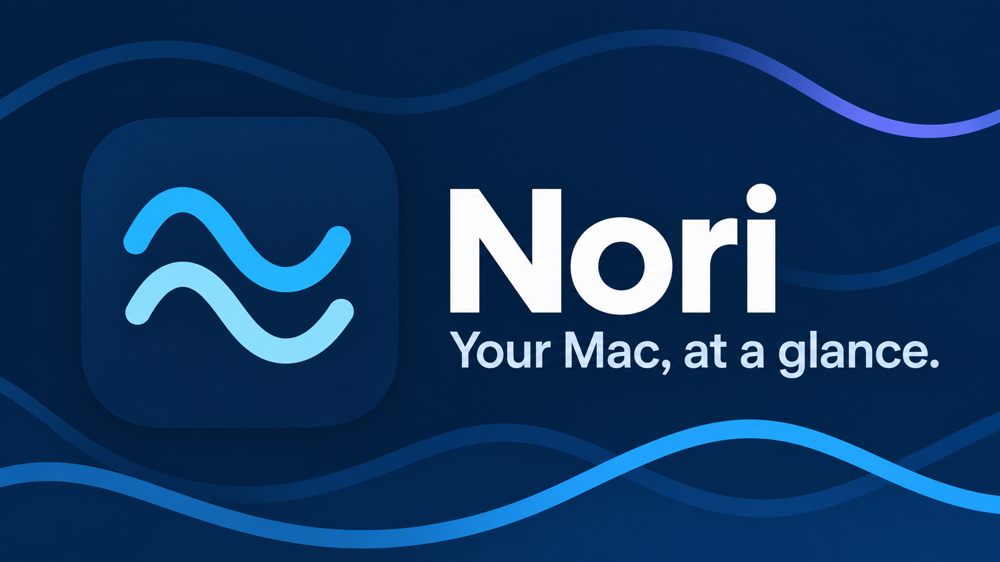
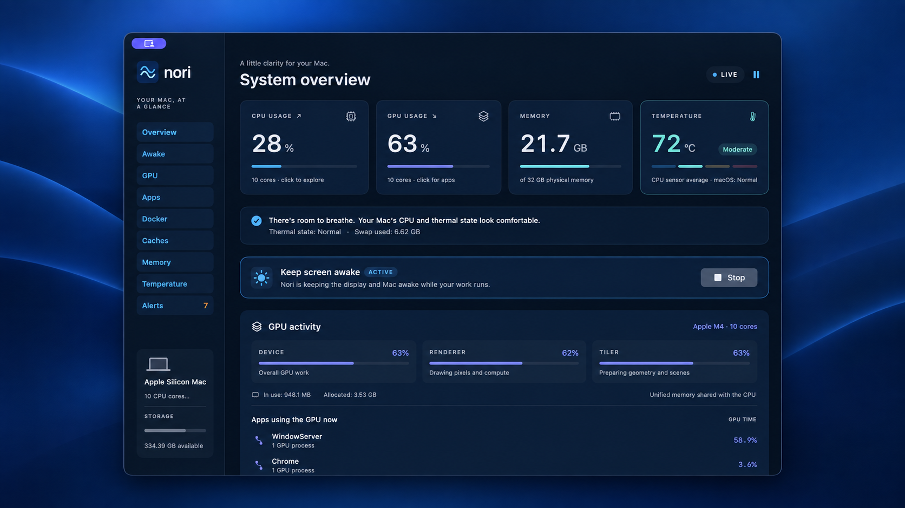
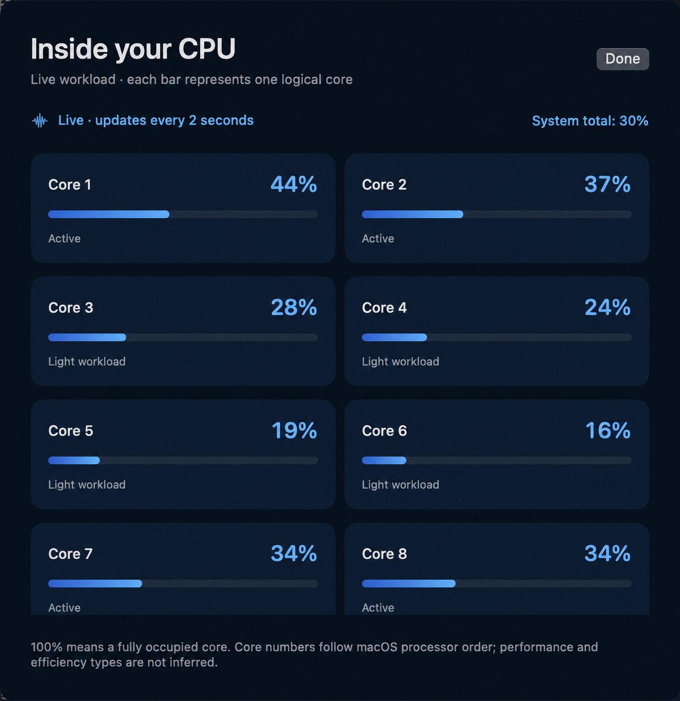
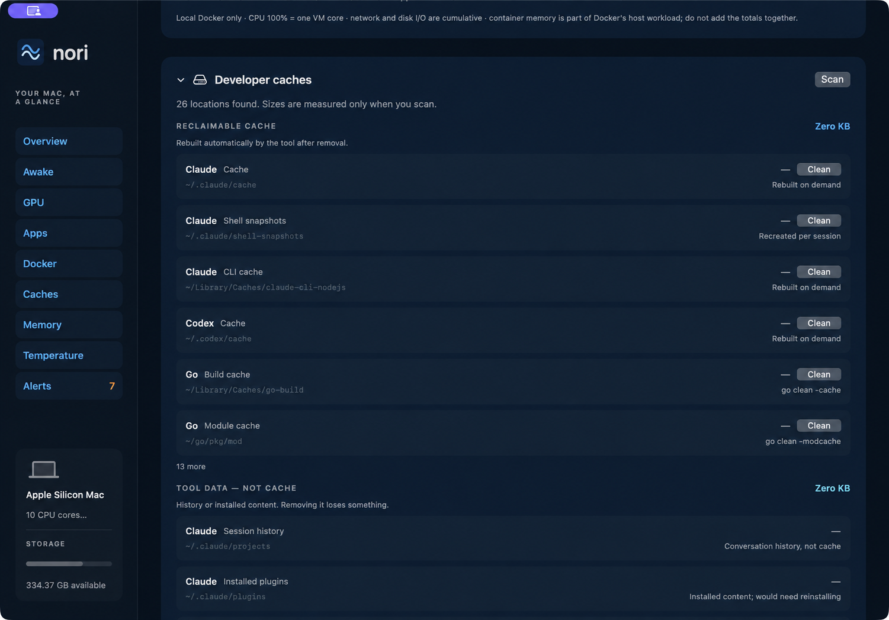

<p align="center">
  
</p>

<h1 align="center">Nori</h1>

<p align="center">
  A calm, ocean-blue command center for a busy Mac.<br>
  See CPU, GPU, memory, heat, apps, Docker, and developer caches in one native dashboard.
</p>

<p align="center">
  
  
  
  <a href="https://github.com/mk-tdev/nori/releases/latest"></a>
</p>

<p align="center">
  <a href="https://github.com/mk-tdev/nori/releases/latest"><strong>Download Nori</strong></a>
  &nbsp;·&nbsp;
  <a href="#install-on-apple-silicon"><strong>Install with Homebrew</strong></a>
  &nbsp;·&nbsp;
  <a href="#features"><strong>Explore features</strong></a>
</p>



Nori turns noisy system metrics into a view you can understand at a glance. It is built with SwiftUI and Swift Charts, runs locally, and stays useful while Codex, Claude, browsers, containers, and builds compete for your Mac.

## See what your Mac is doing

<table>
  <tr>
    <td width="50%" valign="top">
      
      <br><strong>Every core, live.</strong><br>
      Open CPU details to see the workload on each logical core, refreshed every two seconds.
    </td>
    <td width="50%" valign="top">
      
      <br><strong>Reclaim space with confidence.</strong><br>
      Scan developer caches, clean one item at a time, and keep session history and installed tools protected.
    </td>
  </tr>
</table>

## Install on Apple Silicon

Download the latest `Nori-*-apple-silicon.zip` from [GitHub Releases](https://github.com/mk-tdev/nori/releases), unzip it, and move `Nori.app` to Applications.

Nori is distributed for free without Apple Developer ID notarization. On first launch, macOS may block it. After attempting to open Nori once, open **System Settings → Privacy & Security**, scroll to Security, choose **Open Anyway**, and confirm **Open**. Only do this for a download from this repository whose SHA-256 value matches the attached checksum file.

Homebrew installation is also available:

```sh
brew install --cask mk-tdev/tap/nori
```

The same one-time Gatekeeper step applies to the Homebrew installation.

## Build and open

```sh
./scripts/build-app.sh
open dist/Nori.app
```

Use the new `dist/Nori.app`, not the older Pulse bundle. The app is locally signed, not notarized for distribution. Drag it to Applications if desired. Closing the window keeps the menu bar monitor running; choose Quit Nori to exit.

The build needs Xcode command-line tools and Python 3 for the ICNS container. The flat icon is generated reproducibly from vector paths in `scripts/draw-icon.swift`; no image-generation service is used by the app or build.

## Features

- System CPU and memory, sampled every two seconds on a background queue.
- Click CPU for per-logical-core workloads. Core numbers follow macOS order; performance/efficiency types are not inferred.
- Live GPU device, renderer, and tiler utilization; GPU core count; driver memory; a two-minute activity line; and per-app GPU-time attribution from Metal driver counters. No administrator access or `powermetrics` process is required. Compatible IOKit counters are hardware and macOS dependent, so unsupported Macs show an explicit unavailable state.
- App totals combine identifiable helper bundles and descendant processes. Known Codex, Claude, Chrome, and Docker helpers are normalized even when distributed inside another host bundle. Unknown owners remain under the executable name. Search, CPU/memory sorting, Show all, and a live process drill-down are available.
- Local Docker container CPU, memory usage/limit, memory percentage, network totals, block I/O totals, and PID count, refreshed every ten seconds on a separate queue. Refresh is available manually. Requires an installed Docker CLI and a running local Docker Desktop-compatible Unix socket. Remote contexts are deliberately not used. Missing CLI, unavailable daemon, timeouts, malformed responses, and no running containers have explicit states. No containers are started, stopped, or modified.
- Developer cache sizes for known npm, npx, Yarn, pnpm, Bun, Deno, uv, pip, Homebrew, Go, Cargo, Gradle, Maven, Xcode, SwiftPM, Playwright, Puppeteer, Codex, and Claude locations. The entire section can be minimized. Every rebuildable cache row has a one-click Clean action scoped to that exact directory; it disappears from the list after successful cleanup and reports failures inline. Codex and Claude session transcripts, generated images, installed plugins, and the Docker VM disk image are protected tool data and never receive a Clean action. Sizes are measured only when you press Scan, never on the two-second loop.
- Real macOS memory-pressure level (normal, elevated, critical), alongside compressed memory, swap, and page-out rate. If pressure is unreadable, it is shown as unavailable rather than inferred from RAM percentage.
- CPU temperature from available known SMC sensors and independent macOS thermal state. Display colors: blue below 60°C, teal 60–74°C, amber 75–89°C, red at 90°C or above. These are visual guides, not hardware safety limits.
- Temperature history for the last 2, 5, or 15 minutes of the current session. Missing readings and sampling gaps break the line. Activity still shows the last two minutes.
- Sustained-load alerts: CPU at least 85%, temperature at least 90°C, or elevated/critical memory pressure for 60 continuous seconds. Each condition fires once per episode, re-arms after recovery, and resets across pauses/sleep/missed samples longer than eight seconds. The latest 30 alerts are retained in memory; six are shown in the panel. Clear removes history without re-triggering an active episode.
- In-app alerts are enabled by default. Optional Notification Center banners can be enabled in the Alerts panel; macOS permission is required. Alert settings and history are session-only in this version.

## Reading the numbers

System CPU uses all cores as 100%; app and process CPU use one core as 100%. Docker CPU uses one VM core as 100%. These scales should not be compared directly.

Process memory totals sum resident sizes and may count shared pages multiple times. Container memory is already part of the Docker host workload; do not add both numbers together. Docker network and disk I/O are cumulative, not per-second rates. macOS physical memory use is estimated from VM counters with file-backed and purgeable pages excluded; pressure is read independently from the OS.

Cache sizes are allocated blocks reported by `du` at scan time, not live values, and a large scan takes several seconds. Catalog paths never nest inside one another, so the reclaimable-cache and tool-data totals do not double-count; locations outside the catalog are not measured, so the totals are a floor, not your whole disk. Reclaimable cache and tool data are separate totals and should not be added together.

AppleSMC temperature access and IOKit GPU driver counters are private, hardware-dependent, read-only interfaces. Sensor averages are not guaranteed package temperatures, GPU app time and device utilization measure different parts of the graphics pipeline, and not every Mac exposes the same values. The app never writes fan or power settings. Sampling and history remain local, and no administrator helper or telemetry is installed.

## Verification

```sh
swift test --disable-sandbox
dist/Nori.app/Contents/MacOS/Nori --diagnostics
# Also inspect local Docker availability and container statistics:
dist/Nori.app/Contents/MacOS/Nori --diagnostics --docker
# Measure every known developer cache location and print the two totals:
dist/Nori.app/Contents/MacOS/Nori --diagnostics --caches
```

The tests cover app ownership, nested helpers, ancestry cycles, CPU/temperature/pressure display boundaries, Docker JSON and empty/error responses, cache catalog integrity and du parsing, cache measurement of a real directory, sustained alert timing, deduplication, recovery, and sample-gap reset. Diagnostics validate live CPU/core/memory collection and report optional sensor/Docker availability. Restricted terminal environments may deny SMC, pressure, swap, Docker, or home-directory access even when the normal GUI app can read them.

Implementation remains in `Sources/Pulse` and `Sources/PulseSystem` to preserve module continuity. The distributed product, window, menu, icon, and bundle are named Nori.

References: [Docker stats](https://docs.docker.com/reference/cli/docker/container/stats/), [Apple thermal state](https://developer.apple.com/documentation/foundation/processinfo/thermalstate-swift.property), [Apple XNU](https://github.com/apple-oss-distributions/xnu), [sensor key reference](https://github.com/exelban/stats/blob/master/Modules/Sensors/values.swift).
